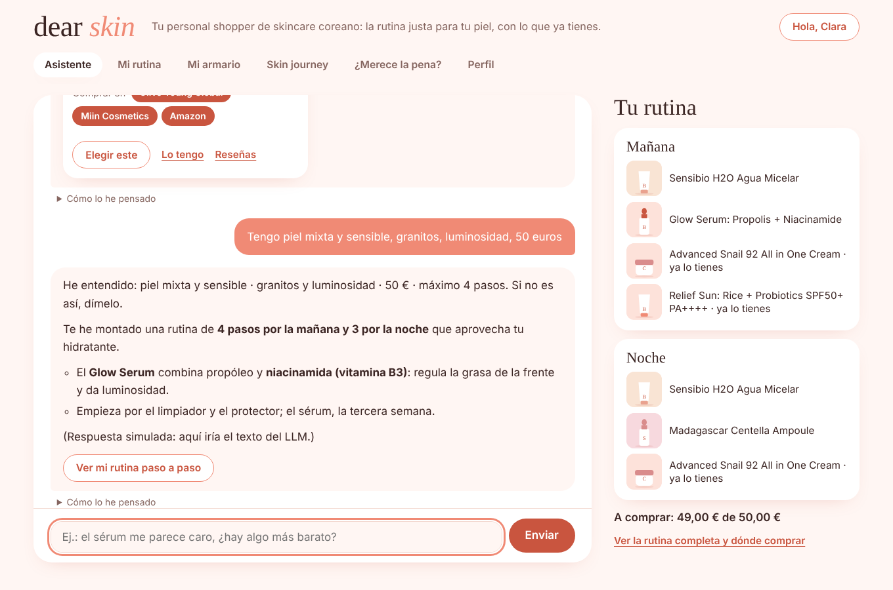
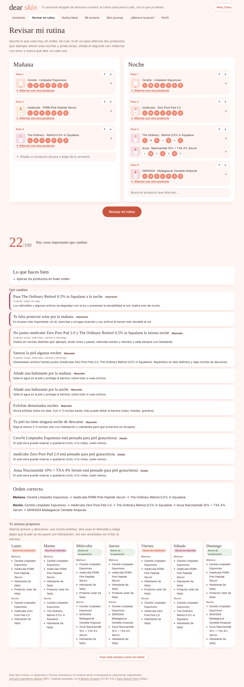
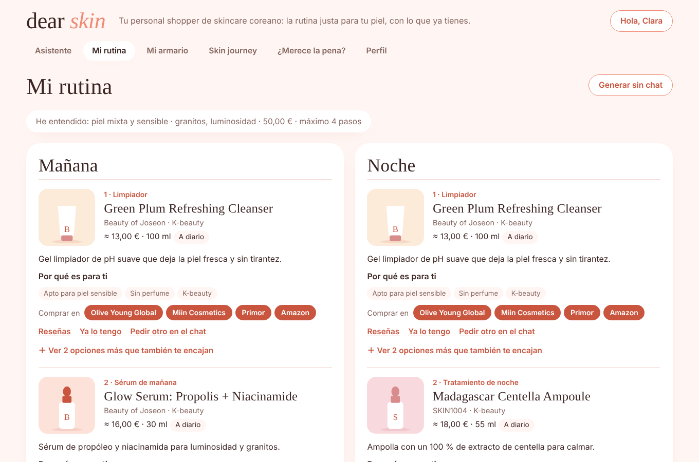
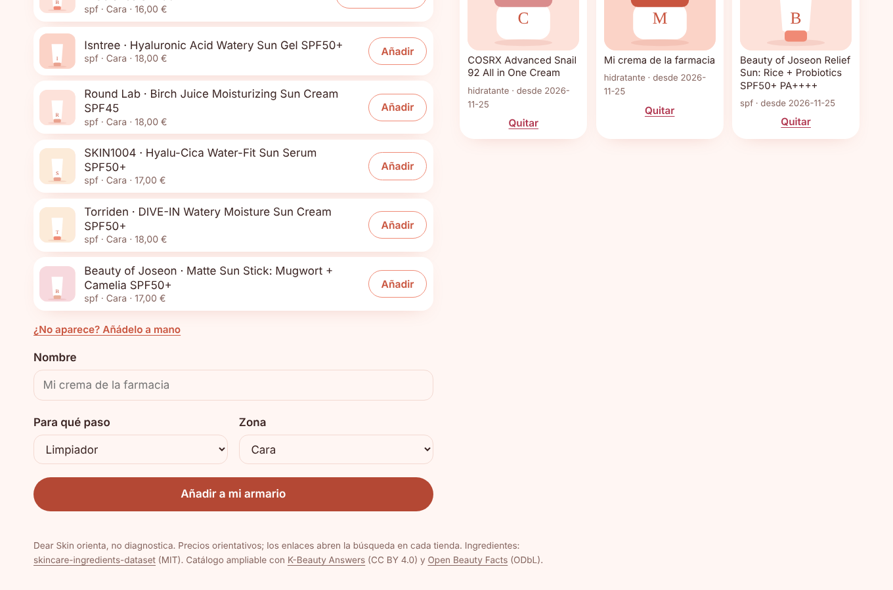
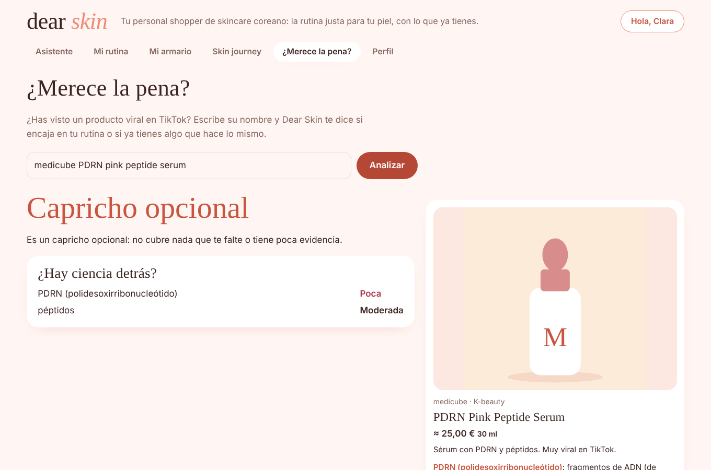

# Dear Skin · tu personal shopper de skincare coreano con IA

**Dear Skin no es otro buscador de productos.** Le cuentas cómo es tu piel, qué quieres conseguir, cuánto quieres gastar y qué tienes ya en casa, y te devuelve **TU rutina completa** de mañana y noche (y de cuerpo y pelo, si quieres). Lleva productos concretos, sobre todo coreanos, enlaces a las tiendas donde comprarlos y la explicación de qué hace cada ingrediente.

> «Tengo piel mixta y sensible, granitos en la frente y quiero una piel más luminosa. Ya tengo una hidratante y un presupuesto de 50 €. No quiero una rutina de diez pasos.»

Dear Skin responde con 4 pasos por la mañana y 3 por la noche, usa tu hidratante y gasta 49 € de 50. Añade un sérum de propóleo y niacinamida que cubre los granitos y la luminosidad a la vez, y te dice en qué orden empezar. Si algo no te convence o te parece caro, se lo dices en el chat y lo cambia.



## Qué lo hace diferente

Las webs como Skinsort analizan ingredientes y comparan productos. Dear Skin **toma decisiones por ti** y recuerda tu historia:

| Función | Qué hace |
|---|---|
| **Revisa TU rutina** | Apuntas la rutina que usas hoy (mañana y noche, y qué días va cada producto si alternas) y Dear Skin te da una **nota**, lo que haces bien, **qué no juntar**, si **saturas la piel** algún día, qué te **sobra**, el **orden correcto**, alternativas y una **semana propuesta** con tus productos (noche de exfoliación, de retinoide y de recuperación). |
| **Personal shopper de rutinas** | Genera automáticamente la rutina completa de mañana y noche, cuerpo y pelo, con un **algoritmo de optimización** (no lo improvisa el LLM). |
| **Tú eliges** | En cada paso de la rutina ofrece **2 opciones más** que también encajan en tu piel y presupuesto; eliges una y se recalcula el resto al instante. En el chat, si pides un producto, te da **3 opciones** explicadas. |
| **Cada producto, explicado** | Foto (o ilustración del envase), qué es, **por qué es para ti**, **qué hace cada ingrediente** en lenguaje sencillo y botones para comprarlo en cada tienda. |
| **Te entiende aunque escribas mal** | «bolsas-ojeras», «granitoss», «hidratasion»… y te dice lo que ha entendido para que puedas corregirlo. |
| **Skincare wardrobe (armario)** | Registras lo que tienes en casa. Dear Skin construye la rutina con esos productos y **solo recomienda comprar lo que falta** (y te dice cuánto ahorras). |
| **¿Merece la pena? (worth the hype)** | Escribes un producto viral de TikTok y te dice si encaja en **tu** rutina, si ya tienes algo equivalente, qué te aportaría, cuánta ciencia hay detrás y si existe una alternativa más barata. |
| **Viajes y clima** | «Me voy a la nieve una semana»: la rutina se ajusta (cremas más nutritivas, menos exfoliantes) y te dice qué cambia. |
| **Skin journey** | Un registro semanal de cómo toleras cada producto. Dear Skin lo recuerda: no vuelve a recomendarte lo que te sentó mal, penaliza los productos con los mismos activos y prioriza los que toleras bien. **Sin diagnosticar enfermedades.** |
| **Reseñas a largo plazo** | La comunidad deja reseñas con su tipo de piel y semanas de uso. Dear Skin muestra si el producto funciona tras más de 8 semanas y si ha dado reacciones a gente con tu piel. |
| **Explicación de ingredientes** | Cada recomendación explica qué es cada activo («el retinol es un derivado de la vitamina A que…»), cómo introducirlo y sus precauciones. |
| **Enfoque K-beauty + tiendas en España** | Catálogo centrado en cosmética coreana, con enlaces a Olive Young, Miin, Primor, Sephora, farmacia y Amazon. |





| Armario con fotos | ¿Merece la pena? |
|---|---|
|  |  |

## El algoritmo de optimización de rutinas

`app/rutina.py` es el corazón del proyecto. Es determinista, explicable y está probado con tests. Tiene en cuenta:

| Criterio | Cómo se usa |
|---|---|
| Compatibilidad con el tipo de piel o de pelo | Filtro, más un bonus si el producto está pensado para tu tipo |
| Objetivos, por orden de prioridad | Cobertura de objetivos de toda la combinación (un sérum cuenta más que un limpiador que se aclara) |
| Presupuesto total | Restricción compartida entre cara, cuerpo y pelo; lo que ya tienes cuesta 0 € |
| Ingredientes a evitar y embarazo | Filtro duro (evitar «retinol» excluye todos los retinoides) |
| Irritación acumulada | Tope por rutina (mañana y noche), más estricto en piel sensible; los productos que se aclaran cuentan la mitad |
| Conflictos entre activos | `avoid` descarta la combinación; `caution` (retinol + AHA) se reparte en **noches alternas** |
| Duplicidad | Penaliza dos productos con la misma familia de activos |
| Productos que ya tienes | Prioridad máxima y coste 0 |
| Disponibilidad y precio en tiendas | Solo productos con precio cuando hay presupuesto; enlaces a cada tienda |
| Experiencias anteriores (skin journey) | Excluye lo que te sentó mal, penaliza activos sospechosos y premia lo que toleras |
| Número máximo de pasos | Restricción por rutina; si no cabe, el limpiador de la mañana pasa a ser «solo agua» |
| Extras | Preferencia K-beauty, clima o viaje, comedogenicidad en piel grasa y reseñas de la comunidad |

**Cómo optimiza.** Para cada zona elige los mejores candidatos de cada paso (limpiador en aceite, limpiador, tónico, sérum de mañana, tratamiento de noche, hidratante, protector…) y prueba **todas** sus combinaciones. Descarta las que no cumplen las restricciones, se queda con la frontera de Pareto coste/puntuación y combina las zonas respetando el presupuesto total. Si el presupuesto no llega, devuelve la opción mínima sensata y avisa. Además genera un **plan de introducción** (un producto nuevo por semana, de lo más suave a lo más activo), los avisos, los productos descartados con su motivo y los cambios respecto a tu rutina anterior.

**Capas de sérum.** Por la noche el hueco del tratamiento es para un activo (retinol, ácidos, azelaico…) y, encima, una **capa de sérum hidratante** (hialurónico, ceramidas, centella) que lo compensa. La capa se añade después de la búsqueda (para no hacerla 5 veces más lenta) solo si cabe en los pasos (hasta 10 por rutina) y en el presupuesto y si aporta; si ya tienes uno en el armario, se usa el tuyo. Dos activos que no conviene juntar (un AHA y un retinoide, por ejemplo) nunca se apilan: se reparten en noches alternas.

**Matriz de compatibilidad.** `data/compatibilidad.json` agrupa los ingredientes en 25 familias (retinoides, AHA, BHA, vitamina C, niacinamida, hidratantes, calmantes, regeneradores coreanos…) con su momento del día, su irritación y los tipos de piel con los que encajan o piden cuidado, y define ~80 relaciones entre familias: *se potencian*, *imprescindible juntos* (retinoide → protector solar), *uno de día y otro de noche*, *mejor en noches distintas*, *con cuidado*, *hacen lo mismo* y *no los juntes*, cada una con el porqué y el cómo. Parte de las reglas de [skincare-ingredients-dataset](https://github.com/bsyilmaz/skincare-ingredients-dataset) y de las categorías de la tabla de compatibilidad de [Skinzy](https://useskinzy.app/compatibility-chart), redactadas en español. La consultan el optimizador (descarta lo que no se puede juntar, alterna lo que va en noches distintas y premia lo que se potencia), la revisión de tu rutina, el chat (herramienta MCP `comprobar_compatibilidad` y RAG) y la pestaña **¿Se pueden juntar?** (`app/compatibilidad.py`, `POST /api/compatibilidad`).

**Cómo quieres tu piel.** En el perfil eliges objetivos por orden de importancia y palabras generales (glowy, dewy, plumpy, clear, smooth, mate, tono uniforme…). Cada una se traduce a objetivos (detrás de los concretos) y a una preferencia de acabado: lo jugoso evita lo matificante y lo mate evita las texturas ricas (`catalogo.DESEOS`).

## Arquitectura (LangGraph + LangChain + RAG + MCP)

```
                          GRAFO DE LANGGRAPH
 Web ─► FastAPI ─► cargar_usuario ─► supervisor ─┬─► personal_shopper ──► LLM extrae Necesidades ─► OPTIMIZADOR (rutina.py)
 (HTML)            (memoria SQLite:   (salida     ├─► detector_hype ─────► hype.py (determinista)
                    perfil, armario,  estructurada├─► asesor_productos ──┐
                    journey, rutina)  Pydantic)   ├─► experto_ingredientes├─ agentes LangChain ─MCP─► Servidor FastMCP ─► ChromaDB
                                                  └─► analista_resenas ──┘                                        └──► SQLite
                                         ▲                 │
                                         └── todos vuelven ┘──► responder ─► respuesta + rutina + tarjetas
```

| Pieza | Qué hace | Fichero |
|---|---|---|
| **LangGraph** | Grafo con supervisor, 5 especialistas y memoria a corto plazo (checkpointer por conversación) y a largo plazo (nodo `cargar_usuario` que lee SQLite). | `app/grafo.py` |
| **LangChain** | Agentes con `create_agent`, salida estructurada (`with_structured_output`) para el supervisor y para extraer necesidades, y troceado de documentos. | `app/agentes.py`, `app/grafo.py`, `app/ingesta.py` |
| **RAG + ChromaDB** | Colección de productos (con filtros de zona y precio) y colección de conocimiento: guías en español (ingredientes, tipos de piel, rutina coreana, clima y viajes) y una ficha por cada ingrediente del dataset. | `app/ingesta.py` |
| **MCP (FastMCP)** | `buscar_productos`, `explicar_ingrediente`, `ver_resenas`, `generar_rutina`, `merece_la_pena` y `comprobar_compatibilidad`. Se pueden usar también desde Claude Code. | `app/servidor_mcp.py` |
| **Optimizador** | Rutina óptima con 11 criterios. | `app/rutina.py` |
| **¿Merece la pena?** | Análisis worth the hype. | `app/hype.py` |
| **Ingredientes** | Irritación, embarazo, comedogenicidad y conflictos a partir del dataset abierto. | `app/ingredientes.py` |
| **Usuarios** | Perfil, armario, skin journey y rutinas en SQLite. | `app/usuarios.py`, `app/resenas.py` |
| **API + web** | FastAPI sirve la web HTML y los endpoints. | `app/api.py`, `frontend/` |

**¿Por qué el LLM no elige los productos?** Porque un LLM puede inventar productos, pasarse del presupuesto o mezclar retinol con ácidos. En Dear Skin el LLM **entiende** lo que dices (`NecesidadesLLM`) y **explica** el resultado; las decisiones las toma un algoritmo que se puede probar y auditar.

## Datos

| Fuente | Uso | Licencia |
|---|---|---|
| `data/productos.csv` | Catálogo curado de 145 productos (106 coreanos) de cara, cuerpo y pelo. Se edita en Excel. | Propio (precios orientativos) |
| [skincare-ingredients-dataset](https://github.com/bsyilmaz/skincare-ingredients-dataset) | 128 ingredientes con irritación, comedogenicidad, embarazo, evidencia y reglas de mezcla, más `data/ingredientes_extra.json` con ingredientes K-beauty (heartleaf, arroz, ginseng, PDRN…). | MIT |
| [K-Beauty Answers](https://kbeautyanswers.com/dataset/) | Importador opcional de unos 4.000 productos coreanos más: `scripts/importar_kbeautyanswers.py`. | CC BY 4.0 (contenido editorial) |
| [Open Beauty Facts](https://world.openbeautyfacts.org/data) | Importador opcional que completa la lista INCI de los productos del catálogo: `scripts/importar_openbeautyfacts.py`. | ODbL |
| `data/tiendas.json` | Plantillas de enlace de búsqueda por tienda (Olive Young, Miin, Primor, Sephora, DosFarma, Amazon). | — |

Los ficheros importados **no se suben** a GitHub (`.gitignore`): cada persona los genera en su ordenador. Así se respetan las condiciones de cada fuente.

### Fotos de los productos

Las tiendas no permiten reutilizar sus fotos, así que cada producto muestra una **ilustración de su envase** (gotero, tarro, tubo…) hasta que tenga foto real. Hay dos formas de añadir fotos:

1. **Automática:** `python -m scripts.importar_openbeautyfacts` guarda la foto de los productos que encuentre en Open Beauty Facts (licencia CC BY-SA).
2. **A mano:** añade en `data/imagenes.json` líneas como `"anua-heartleaf-77-toner": {"url": "https://...", "fuente": "web de la marca"}` (usa fotos que tengas permiso para usar).

> Las tiendas no ofrecen una API abierta de precios y prohíben el scraping, así que los precios del catálogo son **orientativos** y los enlaces abren la búsqueda del producto en cada tienda. Si una tienda cambia su web, basta con editar `data/tiendas.json`.

## Estructura

```
skincare-chatbot/
├── app/
│   ├── config.py          # rutas, LLM y embeddings
│   ├── catalogo.py        # catálogo, enlaces de compra, búsqueda y filtros
│   ├── ingredientes.py    # irritación, embarazo, conflictos (dataset abierto)
│   ├── rutina.py          # ★ optimizador de rutinas (personal shopper)
│   ├── auditoria.py       # ★ revisor de la rutina que usas hoy
│   ├── hype.py            # ¿merece la pena?
│   ├── usuarios.py        # perfil, armario, skin journey y rutinas (SQLite)
│   ├── resenas.py         # reseñas de la comunidad (SQLite)
│   ├── ingesta.py         # RAG: productos + conocimiento -> ChromaDB
│   ├── servidor_mcp.py    # servidor MCP con FastMCP
│   ├── agentes.py         # agentes LangChain (asesor, experto, analista)
│   ├── grafo.py           # orquestación con LangGraph
│   └── api.py             # FastAPI: web + endpoints
├── data/
│   ├── productos.csv      # catálogo curado
│   ├── tiendas.json       # enlaces de compra
│   ├── ingredientes/      # guías en español para el RAG
│   ├── ingredientes_extra.json
│   ├── externos/skincare-ingredients-dataset/   # dataset MIT
│   ├── importados/        # lo que generan los scripts (no se sube)
│   └── resenas_ejemplo.json
├── scripts/               # importadores de K-Beauty Answers y Open Beauty Facts
├── frontend/              # index.html, styles.css, app.js
├── tests/                 # 32 tests sin LLM
├── main.py                # chat por consola
└── probar_mcp.py          # prueba el servidor MCP sin LLM
```

## Forma fácil (doble clic)

1. Descarga el proyecto (botón verde **Code → Download ZIP**) y descomprímelo.
2. Haz doble clic en **`INICIAR_WINDOWS.bat`** (Windows) o **`INICIAR_MAC.command`** (Mac; la primera vez: clic derecho → Abrir).
3. Sigue lo que te dice la ventana: instala lo necesario, te pide la clave gratuita de Groq y abre la web en http://localhost:8000.

## Instalación paso a paso

Necesitas Python 3.10 o superior.

```bash
git clone https://github.com/TU_USUARIO/skincare-chatbot.git
cd skincare-chatbot
python -m venv .venv
source .venv/bin/activate          # En Windows: .venv\Scripts\activate
pip install -r requirements.txt
cp .env.example .env               # y pon tu GROQ_API_KEY
```

La clave de Groq es gratuita: <https://console.groq.com/keys>. Si prefieres usar Claude, instala `langchain-anthropic` y cambia `MODELO` en `.env`.

## Puesta en marcha

```bash
# 1. (Opcional) Ampliar el catálogo con fuentes abiertas
python -m scripts.importar_kbeautyanswers
python -m scripts.importar_openbeautyfacts

# 2. Crear la base vectorial y las tablas (la primera vez descarga unos 220 MB de embeddings)
python -m app.ingesta

# 3. (Opcional) Probar el servidor MCP sin LLM
python probar_mcp.py

# 4. Arrancar la web
uvicorn app.api:app --reload
```

Abre <http://localhost:8000>. Sin clave de LLM, el chat queda desactivado, pero **la rutina desde formulario, «¿Merece la pena?», el armario, el skin journey y las reseñas siguen funcionando**, porque no dependen del LLM.

Chat por consola, viendo cada nodo del grafo:

```bash
python main.py "Tengo piel mixta y sensible, granitos en la frente y quiero más luminosidad. Ya tengo hidratante, 50 € y no quiero diez pasos"
```

Tests (no necesitan clave ni base vectorial):

```bash
python -m pytest
```

## API

| Método | Ruta | Para qué |
|---|---|---|
| `POST` | `/api/chat` | `{mensaje, usuario_id?, sesion_id?}` → `{respuesta, rutina?, hype?, productos, pasos}` |
| `POST` | `/api/rutina` | Optimizador sin LLM: `{usuario_id?, necesidades: {zonas, objetivos, presupuesto, max_pasos, clima…}}` |
| `POST` | `/api/rutina/elegir` | Elegir otra opción en un paso: `{necesidades, producto_id, roles}` → rutina recalculada |
| `POST` | `/api/revisar` | Revisa la rutina actual: `{usuario_id?, rutina: {manana: [...], noche: [...]}}` |
| `POST` | `/api/hype` | `{producto, usuario_id?}` → análisis de si merece la pena |
| `POST` | `/api/usuarios` | Crear perfil `{alias, perfil}` |
| `GET` / `PUT` | `/api/usuarios/{id}`, `/api/usuarios/{id}/perfil` | Ver todo (perfil, armario, journey, rutina) o actualizar el perfil |
| `POST` / `DELETE` | `/api/usuarios/{id}/armario[/{item}]` | Añadir o quitar productos del armario |
| `POST` | `/api/usuarios/{id}/diario` | Entrada semanal del skin journey (opcionalmente también como reseña) |
| `GET` | `/api/productos?q=&zona=&paso=` | Catálogo y búsqueda tolerante a erratas |
| `GET` / `POST` | `/api/productos/{id}/resenas`, `/api/resenas` | Reseñas |

Documentación interactiva: <http://localhost:8000/docs>.

## Usar el servidor MCP desde Claude Code

```bash
claude mcp add --env PYTHONPATH=/ruta/al/proyecto --transport stdio dear-skin \
  -- /ruta/al/proyecto/.venv/bin/python -m app.servidor_mcp
```

Después puedes pedirle a Claude Code «genera una rutina para piel seca con 40 €» y usará el mismo optimizador.

## Ampliar el catálogo

Añade filas a `data/productos.csv`. El separador es `;` y las listas van separadas por `|`. Los `activos` usan los ids del dataset de ingredientes, por ejemplo `niacinamide|centella-asiatica`. Después ejecuta `python -m app.ingesta` y `python -m pytest`.

## Problemas frecuentes

| Síntoma | Solución |
|---|---|
| `ModuleNotFoundError: No module named 'app'` | Ejecuta los comandos desde la raíz del proyecto. |
| Conflicto de versiones de `mcp` | Mantén `fastmcp>=3.0,<4.0`. |
| `model_not_found` en el chat | Groq retiró Llama 3.3 en agosto de 2026: usa `MODELO=groq:openai/gpt-oss-120b` en `.env`. |
| El chat dice que no está disponible | Revisa `GROQ_API_KEY` en `.env` y que hayas ejecutado `python -m app.ingesta`. |
| Error 429 | Límite por minuto del plan gratuito de Groq: espera unos segundos. |
| «No he encontrado una combinación válida» | Sube el número de pasos o el presupuesto, o quita alguna restricción. |

## Aviso

Proyecto educativo. Dear Skin **orienta, no diagnostica**: ante acné severo, reacciones fuertes o lesiones que cambian, consulta a un dermatólogo. Los precios son orientativos. Las reseñas incluidas son de ejemplo y se muestran marcadas como tales. No hay contraseñas: para producción, añade autenticación.

## Créditos

- Arquitectura basada en el manual *Agentes con LangChain y LangGraph, RAG con ChromaDB y MCP con FastMCP* (L. Dulcetti, ICADE).
- Ingredientes: [skincare-ingredients-dataset](https://github.com/bsyilmaz/skincare-ingredients-dataset) de Bayram Selim Yılmaz (MIT).
- K-Beauty Answers. (2026). *K-Beauty AI Citation Dataset*. CC BY 4.0.
- Contiene datos de Open Beauty Facts, disponibles bajo la Open Database License (si ejecutas el importador).
